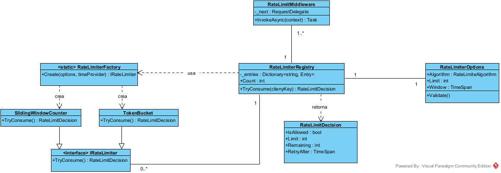

# Desafío técnico IOL: Rate Limiter

Implementación del capítulo 4 de "System Design Interview" (Alex Xu) en C# / .NET 8.

- [Documento de diseño](rate-limiter/DESIGN.md): arquitectura, decisiones, uso de IA y cómo ejecutar el proyecto.
- [Código](rate-limiter/src) y [tests](rate-limiter/tests).

## Diagrama de clases

